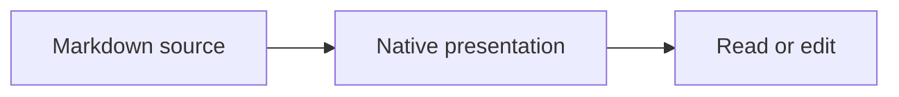

# Live preview example

Use the book/pencil button or **Cmd+Shift+M** on macOS (**Ctrl+Shift+M** on Linux).

Move the caret into this heading to reveal its markers. Existing **bold**, *italic*, ~~strike~~ and [links](https://github.com/ponchoalv/omawrite) keep their source Markdown.

## Table

| Element | Inactive | Editing |
| :--- | :---: | ---: |
| Heading | Styled | Source markers |
| Table | Rendered | Pipe Markdown |
| Image | Picture | Markdown reference |

Click the rendered table to edit its source, then move the caret outside it. Check undo/redo and select across the block in both directions.

## Screenshot paste

Copy a screenshot to the clipboard and paste it into a blank paragraph below. Save this document to a writable folder. The attachment should appear under `img/`, and its reference should remain ordinary Markdown. Undo should remove the reference without deleting the image file.

Paste here.

## Mermaid (optional renderer)



Without a Mermaid renderer, source/error fallback must stay usable; the app must not download a renderer automatically. The usual Mermaid CLI needs external Node/Chromium even though OmaWrite does not embed WebEngine.

## Fenced syntax must stay literal

```markdown
| Not | a rendered table |
| --- | --- |
| Inside | fenced code |


```

## Failure checks


Missing images and incomplete diagrams must not cause a modal interruption or change the saved source. Test Save As to a different folder with an actual pasted image; attachments must either remain resolvable or the save must fail visibly.
