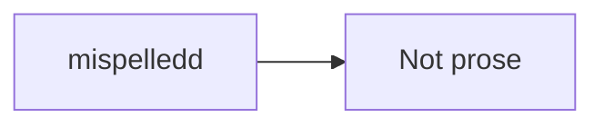

# Spelling example

Choose an installed English spelling dictionary in Edit mode. The deliberately
misspelled words below are test data; the app must not correct them automatically.

The dictionnaryy contains a correct word and a mispelledd word.

**Spelling** should also work in *emphasized prose*, headings and visible
[link labels with a mispelledd word](https://example.invalid/mispelledd-path).

> A quote with a mispelledd word.

- A list item with a mispelledd word.
- Another item with correct spelling.

## These should not be checked

Inline code: `mispelledd`. Multiple-backtick code: ``a `mispelledd` value``.

Bare URL: https://example.invalid/mispelledd-path


```python
mispelledd_variable = "mispelledd string"
```



## Manual checks

1. Right-click a flagged prose word and accept a suggestion. Undo should restore
   that one word; changing the spelling language must not enter the undo stack.
2. Ignore a word for the session. Do not choose Learn unless you actually want to
   add it to your backend's personal dictionary.
3. Turn spelling off and on, then switch Edit/Read/Edit. Read should stay clean.
4. Check the word near an emoji: 😀 mispelledd. Source offsets must remain correct.
5. Start an IME composition and switch language after committing it. No stale
   suggestion should replace unrelated text.
6. With a real local image elsewhere in the document, confirm its attachment
   context menu still works. Spelling must not decorate its rendered object.

For a Spanish dictionary, try this sentence separately:

Este diccionario contiene una palabra correcta y una palabraa mal escrita.
